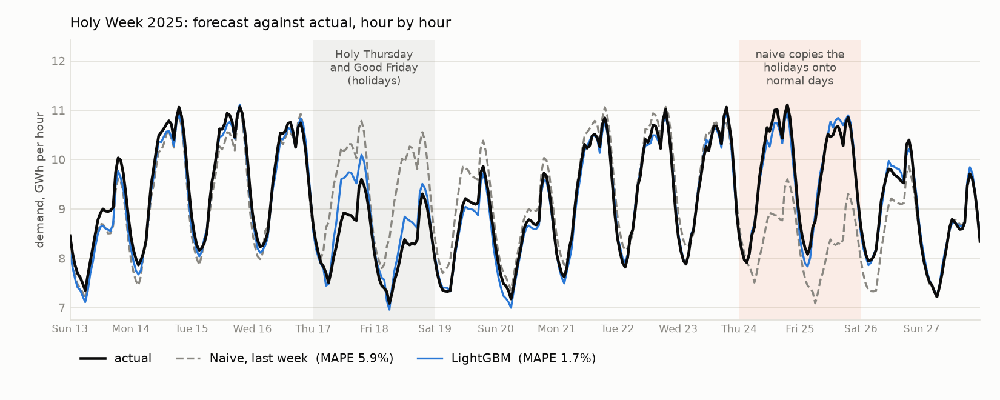
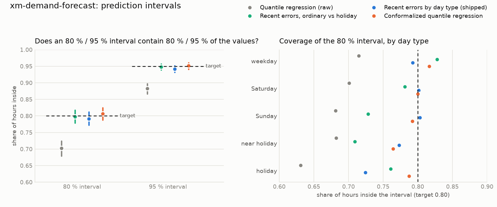

# xm-demand-forecast

[](https://github.com/Juanangara/xm-demand-forecast/actions/workflows/ci.yml)

Day-ahead hourly forecast of electricity demand in Colombia, built as an end-to-end ML exercise: real data from the national grid operator (XM), honest time-series validation, comparison against strong baselines with significance tests, experiment tracking, a REST API in a container, drift monitoring, and CI.

At 00:00 of day D, using only what happened before, the model forecasts the 24 hours of D. On 2023-2026 data it reaches **1.64 % MAPE**, against 3.37 % for "same hour last week" and 2.25 % for a classical MSTL model.

This repo is also a measurement log: the [development log](docs/DEVLOG.md) records what worked, what did not, and which claims were withdrawn.

## Features
- Data pipeline over the XM API (`pydataxm`): 26 years of hourly demand (2000-2026), cached month by month as Parquet, with a data-quality report and an anomaly audit
- Leak-proof setting: every feature uses values at least 24 h old, and a test proves it by rewriting everything from day D onwards
- Walk-forward validation: 46 monthly folds, retraining at the start of each month, scored by day type (ordinary / holiday)
- Colombian public-holiday calendar as features (holidays are 9 % of the hours but 28 % of the baseline's error)
- Comparison against a seasonal-naive baseline and a classical MSTL model, with Diebold-Mariano tests and block-bootstrap confidence intervals
- Training window chosen on a validation split that precedes the test period
- A daily refresh script with a data-quality gate (it rejects the provisional days XM sometimes returns) and a prospective track record of its own forecasts
- 80 % and 95 % prediction intervals, with their calibration measured (coverage with confidence intervals, by day type) against two alternative methods
- MLflow experiment tracking and model registry
- FastAPI service in Docker, with input validation and explicit errors
- Drift monitoring (level, daily shape, model error) calibrated on clean data and tested by injecting failures; Evidently report
- CI with GitHub Actions: lint, tests on synthetic data, Docker build

## How it works


1. `scripts/download.py` pulls `DemaReal` (real demand of the national system, kWh per hour) month by month and reports gaps, duplicates and zeros per year.
2. Reviewed anomalies are masked **only for training**; the raw series is never edited and the test period is never masked.
3. The model predicts `y / lag_168` (the change relative to the same hour last week) from scale-free features, so it does not have to extrapolate the 2x growth in demand since 2000.
4. Each model is scored on the same hours and compared with paired tests on daily errors.

## Results
Test period: 2023-01 to 2026-10 (46 monthly folds, 1,400 days, 33,600 hours), same hours for every model.

| Model | MAPE | Ordinary days | Holiday-affected days |
|---|---|---|---|
| Naive, same hour last week | 3.37 % | 2.63 % | 10.91 % |
| MSTL (classical, no calendar) | 2.25 % | 1.84 % | 6.38 % |
| **LightGBM, last 5 years** | **1.64 %** | **1.58 %** | **2.20 %** |

LightGBM beats the naive baseline in 46 of 46 months. Against MSTL the difference is 0.61 MAPE points (95 % block-bootstrap CI -0.77 to -0.47) and, on ordinary days alone, 0.26 points (CI -0.38 to -0.16), so the gain is not only holiday handling.


What the figure shows:
- **Holidays are where the models differ most.** On holiday-affected days the error is 10.9 % for the naive baseline, 6.4 % for MSTL and 2.2 % for LightGBM; on ordinary days the three are much closer (2.6 %, 1.8 %, 1.6 %).
- **Not a clean sweep.** LightGBM is below MSTL in 41 of 46 months, not all of them; the worst month is 2024-09 (2.47 % against 1.94 %). On Saturdays the two tie at 1.6 %, to one decimal.
- **The intervals are far from zero** for every comparison in the last panel, including ordinary days against MSTL (0.26 points, the smallest).



A concrete case: Holy Thursday and Good Friday 2025 (17-18 April). The naive baseline copies the previous week and misses by 12.9 % on those two holidays; LightGBM misses by 3.9 %, and the figure shows it still overshoots the holidays themselves. One week later the naive baseline copies the holidays onto two ordinary days and misses by 13.9 %, while LightGBM, which knows about the holidays, misses by 1.6 %. Over the whole fortnight: 5.9 % against 1.7 %. It is one example chosen because it is clear, not a typical week.

What these numbers do **not** say:
- The test period was not untouched: the holiday features were designed after looking at the baseline's errors on it, so 1.64 % is probably a little optimistic.
- Neither MSTL nor LightGBM was tuned.
- Differences between training windows (5 years vs. all history) are real but tiny (about 0.06 points).

Details, tests and caveats: [docs/DEVLOG.md](docs/DEVLOG.md) and [docs/MODEL_CARD.md](docs/MODEL_CARD.md).

## Prediction intervals
A point forecast says little about how much to trust it, so the service also returns 80 % and 95 % intervals. Four ways of building them were compared walk-forward on 2023-04 to 2026-10 (1,310 days), by **coverage**: does an 80 % interval contain the real value about 80 % of the time?



| Method | 80 % interval: coverage (95 % CI) | 95 % interval | Width of the 80 % interval | Pinball loss |
|---|---|---|---|---|
| LightGBM quantile regression, raw | 70.2 % (67.9-72.4) | 88.3 % | 4.5 % | 0.284 |
| Recent errors, ordinary vs holiday | 79.7 % (77.8-81.8) | 94.8 % | 5.2 % | 0.265 |
| **Recent errors by day type (shipped)** | **79.1 % (77.2-81.2)** | **94.1 %** | **5.1 %** | **0.265** |
| Conformalized quantile regression | 80.6 % (78.8-82.5) | 95.1 % | 5.6 % | 0.271 |

- **The obvious method fails.** Raw quantile regression is clearly overconfident (70 % instead of 80 %). My guess is that it learns the spread of the data it was trained on, which is smaller than the spread on new data; I did not test that.
- **The shipped method is the simple one:** the point forecast times (1 + quantiles of the model's own errors over the last year), separately for each kind of day. It needs no extra models, only stored numbers.
- **Its weak spot is holidays:** 72.4 % coverage for the 80 % interval on holidays, against 78.7 % for the conformalized version, which is about 9 % wider and needs four more models. I chose simplicity and wrote the trade-off down.
- In the Holy Week example, 85 % of the hours fall inside the 80 % band over the fortnight, but only 52 % on the two holidays themselves, where the model overshoots.

The method was picked among four after seeing this same evaluation period, so these coverage numbers are somewhat optimistic for the shipped one. The service uses quantiles fixed when the model was trained; they should be recomputed whenever it is retrained.

## Quick start
Requirements: Python 3.12 and Docker. **The data is not in this repo**: it is rebuilt from the XM API (see [Data](#data)).

```
# 1. Environment
python -m venv .venv
.venv/Scripts/pip install -r requirements.txt        # Linux/Mac: .venv/bin/pip

# 2. Data (about 320 monthly requests; cached, so re-runs are fast)
python scripts/download.py

# 3. Baselines, model, comparison
python scripts/baselines.py
python scripts/train_lgbm.py
python scripts/stat_baseline.py        # slow: 1,400 daily refits (about 1 s each on one core)
python scripts/select_window.py
python scripts/compare.py
python scripts/intervals.py            # prediction intervals; about 10 minutes (4 quantile models x 46 months)
python scripts/make_figures.py         # redraws docs/results.png and docs/holy_week.png
python scripts/make_drift_figure.py    # docs/drift.png; about 2 minutes (trains two models)

# 4. Final model for the API (writes models/champion/)
python scripts/train_final.py

# 5. Serve (and, optionally, `python scripts/refresh.py` to update the history from XM first)
docker compose up --build
curl "http://localhost:8000/forecast?date=2026-10-12"   # any date inside your history, or the day after it ends
```
Experiments are in MLflow: `mlflow ui --backend-store-uri sqlite:///mlflow.db`.

Tests and lint (no data needed):
```
pip install -r requirements-test.txt
ruff check src tests scripts && pytest -q
```

## API
| Method | Path | Description |
|---|---|---|
| GET | `/forecast?date=YYYY-MM-DD` | 24 hourly forecasts in kWh with 80 % and 95 % intervals, day type, holiday flag, model version; the day's MAPE when real values exist |
| GET | `/health` | Status and the span of the loaded history |
| GET | `/model` | Model metadata: training end, features, code commit, reference metrics |

Each hour carries `lower_80_kwh`, `upper_80_kwh`, `lower_95_kwh` and `upper_95_kwh`, and `interval_method` names how they were built (they are absent if the model has no interval spec). They are wider on holidays than on ordinary weekdays, by construction (about 6.8 % against 4.3 % wide for the 80 % interval in an example). A day whose previous hour is not in the history returns `422` with a message saying what is missing. For days inside the training window the response carries `in_sample: true`, because the `mape_pct` it shows is then optimistic; the honest accuracy figure is the walk-forward result above.

## Drift monitoring
`scripts/simulate_drift.py` deploys a model frozen in 2023 and injects three failures (demand +10 %, a change in the evening profile, and a kWh-to-MWh pipeline bug). Main findings:
- No single monitor catches everything: the error-based monitor misses the profile change, because the model adapts through its lag features; only the shape monitor sees it.
- Retraining when the error alarm fires gained at most 0.05 MAPE points, and cannot fix a broken input. The frozen model scores 1.65 % against 1.64 % for the monthly-retrained one, so the policy is "an alarm opens an investigation", not "an alarm retrains".


Each line is a monitor's signal divided by its own threshold (calibrated on 2021-2022, never on this period), so 1 is the alarm line; the failure starts on 3 June 2024 in the three panels where it is marked. In the figure:
- **Demand +10 %:** the level monitor crosses the line only briefly, and the error monitor barely touches it. A smaller shift would not have been caught.
- **Evening profile change:** only the shape monitor (green) alarms; the error monitor stays under the line.
- **Unit bug:** the level and error monitors go orders of magnitude above the threshold from the first days.
- **They fall back below the line after about two weeks** (both windows then hold the new regime), and in the clean panel the signals stay under it. Over the whole 1,400-day clean run, though, the monitors still raised 10 (level), 10 (shape) and 16 (error) alarm days: they are not free of false alarms (DEVLOG, Phase 10).

`scripts/drift_report.py` writes an Evidently report for the profile-change case.

## Daily refresh
`python scripts/refresh.py` re-reads the last days from XM, forecasts the first day that has no accepted data yet, appends that forecast to a log, and prints how earlier forecasts did against the real values that have arrived since. Everything is written under `data/` (not versioned) and nothing is published. `--dry-run` queries and reports without writing. It is meant to be scheduled with the operating system (cron, Windows Task Scheduler); restart the API afterwards, since it reads the history at startup.

What running it for the first time showed, and how it is handled:
- **XM publishes with a delay of several days.** On 22 November the latest data was from the 19th, so the "next day" to forecast is already in the past. The forecast is made before its real values are published, which keeps the record honest, but this is **not** a real-time day-ahead service: with lags of 24 and 48 hours, the model cannot forecast today or tomorrow until the data for the days before them exists.
- **The most recent days can be provisional.** XM returned 18 and 19 November with 24 hours each but only 59 GWh a day, against about 250 normally (0.24x). A day is accepted only if its daily demand is between 0.6x and 1.4x that of the same weekday in the previous four weeks (over 9,794 days since 2000 the ratio has ranged from 0.70, on New Year's Day, to 1.25). Rejected days stay out of the history and are re-read on the next run, when XM may have revised them.
- **The gate has limits.** A day that is, say, 80 % complete would pass, and a day accepted today could still be revised by XM later, which would change how the forecast made for it is scored.
- **The first forecast made for a day is never overwritten**, so the log cannot be flattered after the fact. Its record is prospective with respect to data availability, not with respect to the calendar: that day has already happened, and its demand may well be visible in other XM sources (I did not check).

## Repository layout
```
src/xmforecast/   data, quality, audit, calendar, features, evaluate, forecast,
                  intervals, refresh, stats, monitor, serving, api
scripts/          download, baselines, train_lgbm, stat_baseline, select_window,
                  compare, intervals, train_final, refresh, make_figures, make_drift_figure, error_analysis, simulate_drift,
                  drift_report
tests/            synthetic-data tests, including the leak and API tests
docs/             DEVLOG.md (measurements and decisions), MODEL_CARD.md, figures
```

## Data
Demand comes from [XM](https://www.xm.com.co) through the `pydataxm` package (source: XM). No data file and no trained model are included: they are rebuilt with the scripts above. The repository does show results derived from the data: aggregate error tables and figures, one of which (`docs/holy_week.png`) plots two weeks of real hourly demand.

On reuse terms: the `pydataxm` and SIMEM client code is MIT-licensed, but I found no licence or terms for the data itself, and XM's website terms (read only in part) restrict copying and publishing its content without authorization; I could not read the SIMEM terms, and it is unclear whether the website terms cover the API. Treat reuse of the data as unresolved: rebuild it yourself with the scripts, do not redistribute it, and ask XM if you need to.

## Limitations
- It is not a live service. The history is a Parquet file, the refresh script updates it when you run it, and XM publishes several days late, so the forecast is always for a day that has already happened (see Daily refresh). Nothing is scheduled for you.
- The API has no authentication, rate limiting or load tests.
- The prediction intervals under-cover on holidays (about 72 % for the 80 % interval), their method was chosen after seeing the evaluation period, and the quantiles are fixed at training time.
- Drift monitoring is an offline simulation with three synthetic failures; it is not wired to the API.
- Only the national system total is modelled, and the Colombian holiday calendar comes from the `holidays` package, checked against my own knowledge but not against the official decree.
- Weather was deliberately left out: for a day-ahead forecast only *forecast* weather would exist, and using observed weather would leak information.
- CI runs on every push (badge at the top): lint, tests on synthetic data and the Docker build. The Docker job only builds the image, and there is no deployment step.
